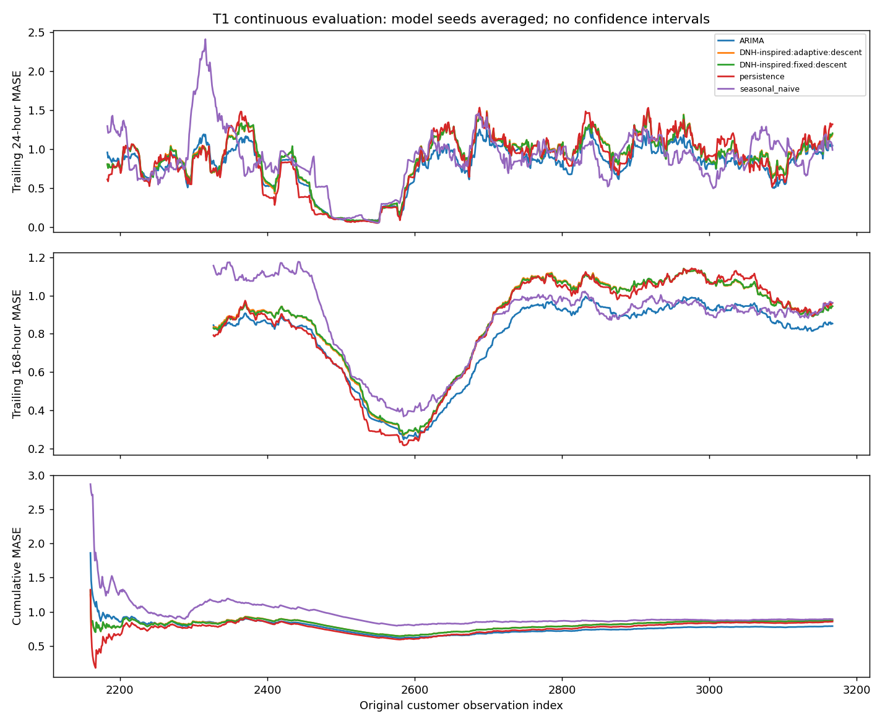
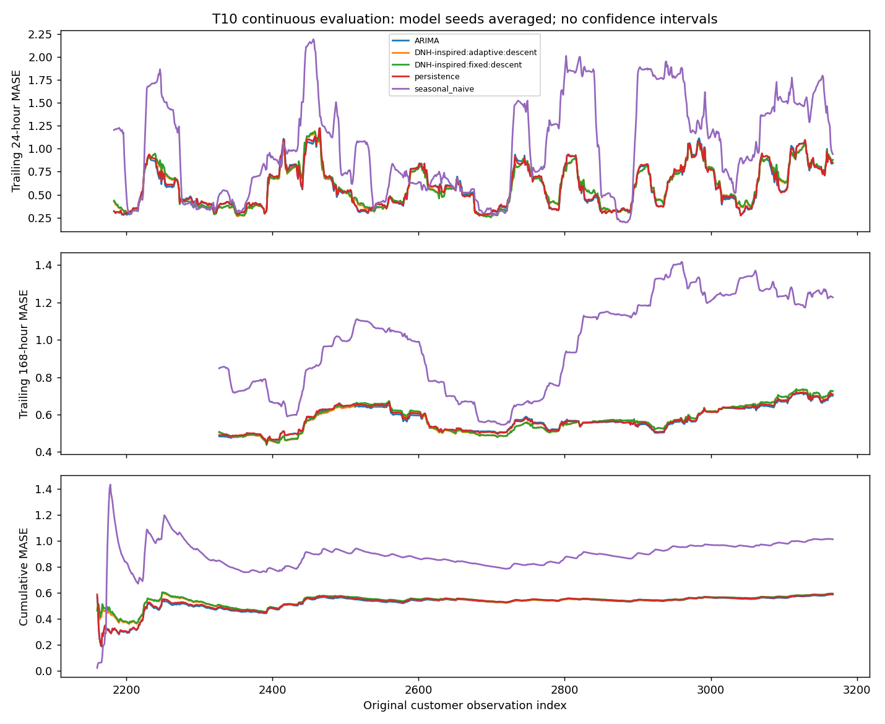
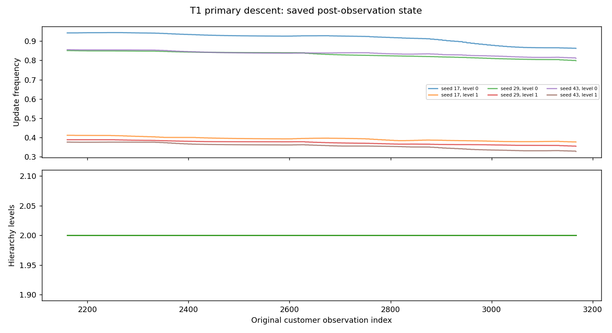
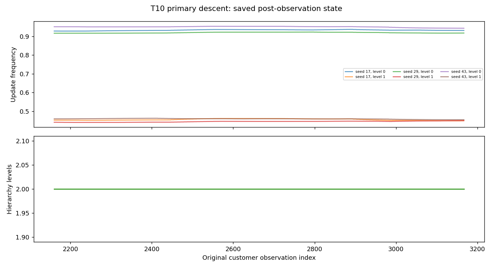

# Frozen continuous-stream evaluation: actual results

Primary settings were frozen and pushed in commit
`c86ff8edc972810436b68db842ec91651f878a9e` **before this evaluation started**.
The implementation source commit is `1dbd0bd`; the full frozen protocol is
[frozen_primary.json](frozen_primary.json), identical to
configs/frozen_primary_continuous.json. Freeze hash:
`5457b9c3654d60e8ad3171f26d998aab7f5a22e7ac3dc6d3af098908effe6a2c`.
No model setting was revised after observing these evaluation results.

## Executed scope and continuity

Two independently modeled original electricity customers, T1 and T10, selected
lexicographically. Development: indices 0–2159 (2,160 hours). Evaluation:
indices 2160–3167, exactly 1,008 hourly targets per customer, from
2012-03-31 00:00:01 through 2012-05-11 23:00:01 (archive timezone unspecified).
This is an initial 42-day continuation, not full-calendar coverage.

Primary: **DNH-inspired adaptive descent**, model seeds 17/29/43. All other settings
remain those in the freeze: width 6, lag 24, initial two levels, maximum four,
growth/pruning patience 8, growth threshold .5, pruning gradient threshold .02,
relative-frequency Adam updates and fixed development normalization. The paired
fixed hierarchy freezes BOTH structure and frequencies but keeps local memory
updates; it is not a growth-only ablation. No literal-ascent variant was evaluated
as another primary candidate on this new period. All models used the same revealed
target stream; no covariates, interpolation, cross-customer weight transfer or
random split.

All 14 model runs completed in a single fresh, uninterrupted evaluation segment;
none resumed, reset at chunks, or reinitialized at reporting boundaries. Each
hierarchy checkpoint records 3,144 supervised observed pairs (3,168 observations
minus initial lag 24). Each ARIMA final state records 3,168 observations. The
saved segment manifests and audit checks establish this software continuity;
they do not establish DNH fidelity or scientific validity.

## Final forecasting errors

Lower is better. MASE denominators use development-only lag-24 differences.
Model seeds are averaged within each customer before giving customers equal
weight in macro MASE. No adjacent hours or seed replicas are treated as independent
customer samples; no inferential confidence interval is claimed.

| Model | Macro MASE |
|---|---:|
| ARIMA, revised selector | 0.687671 |
| Persistence | 0.722757 |
| DNH-inspired adaptive descent (primary) | 0.733095 |
| DNH-inspired fixed hierarchy | 0.733965 |
| Seasonal naive (lag 24) | 0.951769 |

**The primary did not outperform ARIMA or persistence on macro MASE.** Its small
advantage over fixed is not evidence of a significant or structural benefit.

| Customer | Model | MAE | RMSE | MASE |
|---|---|---:|---:|---:|
| T1 | ARIMA | 14.336398 | 20.097346 | 0.790300 |
| T1 | Primary, seed average | 15.887569 | 22.667516 | 0.875809 |
| T1 | Fixed, seed average | 15.869165 | 22.677196 | 0.874794 |
| T1 | Persistence | 15.540675 | 24.368920 | 0.856686 |
| T1 | Seasonal naive | 16.188492 | 24.800274 | 0.892398 |
| T10 | ARIMA | 28.933793 | 45.660172 | 0.585041 |
| T10 | Primary, seed average | 29.197873 | 44.293312 | 0.590381 |
| T10 | Fixed, seed average | 29.334061 | 44.330531 | 0.593135 |
| T10 | Persistence | 29.121032 | 45.652131 | 0.588827 |
| T10 | Seasonal naive | 50.006944 | 85.036214 | 1.011140 |

The RMSE ranking differs from MAE on T10; no single-metric universal superiority
is claimed. Full per-seed values and descriptive seed spread are in
[metrics_by_series_seed.csv](metrics_by_series_seed.csv) and
[metrics_by_series.csv](metrics_by_series.csv).

## Rolling and cumulative errors

[All trajectories](forecast_error_trajectories.csv.gz) contain per-target 24-/168-hour
trailing MAE/RMSE/MASE and expanding cumulative MAE/RMSE/MASE, calculated post-hoc
from saved forecasts. Rolling metrics require full windows (first 23/167 values
undefined); cumulative metrics start at the first evaluation forecast. No rolling
boundary affects optimizer/memory state or feeds back into model selection.
[Macro curves](macro_error_curves.csv) average scaled errors after seeds/customers.
Final cumulative metrics were checked against final per-series/seed metrics.

These curves are descriptive natural-data results. Low-error intervals, outliers
or later error increases alone do not identify known drift or causal adaptation.

## ARIMA schedule actually executed

Candidate orders: (1,0,0), (2,0,0), (1,1,0), (1,1,1). Each fits the first 1,992
development targets and validates with one-step forecasts on targets 1992–2159.
Validation receives each newly revealed development target without parameter
refits; select MAE, then refit the selected order on all 2,160 development values.
Orders selected: **T1 (1,1,1); T10 (1,1,0)**. The orders stayed fixed in evaluation.

Each customer recorded 1,002 filtered appends plus **six parameter refits** after
168, 336, 504, 672, 840 and 1,008 revealed evaluation targets. Refits use the
complete expanding revealed history, including the just-revealed target. No
failed state update, failed refit or forecast fallback occurred. Initial trial
warnings/convergence details remain in each baseline run.json.
[The actual ledger](ARIMA_update_ledger.csv) records every evaluation update.

## Structural activity and frequencies

Across six primary runs there were 6,048 growth checks and 6,048 pruning checks
during evaluation. **No growth/pruning proposal was made or accepted**; all
hierarchies remained at two levels throughout development and evaluation.
Growth gates failed the loss threshold 5,206 times and consecutive-step patience
842 times. No non-root level met the sustained low-gradient pruning rule.
These were eligibility failures, not rejected proposals or size-limit rejections.

Primary evaluation frequencies ranged approximately 0.327876–0.954219; the fixed
counterpart retained 0.5/1.0. Frequencies did adapt, while structure did not.
Therefore any primary/fixed performance difference cannot be credited to realized
structural adaptation. [Counts](structural_counts.csv), per-target structure.csv.gz,
and all proposal/event records in run.json are retained for every hierarchy run.
Full detailed decision JSON and trusted pickle checkpoints remain local.

## Measured CPU cost and audits

Total model-call wall time: **127.15 seconds** (excludes initial archive parsing
and post-hoc summary plots). ARIMA calls took 31.37 s (T1) and 58.80 s (T10),
including development order selection/refit. Primary calls took 2.99–5.05 s per
customer/seed; fixed calls 1.98–2.82 s. Periodic checkpointing is included; every
24 evaluation observations and on final return, without resetting state.
Wall time also includes final CSV/JSON serialization and per-run auditing.

Sampled shared-process RSS reached about **311.6 MiB**. This includes dataset,
interpreter and prior sequential models; it is not isolated model memory or a
true allocation peak. Actual device was CPU; no GPU was used. OMP/OPENBLAS/MKL thread counts
were set to 1 in the recorded [execution command](execution_command.txt).
[Costs and continuity](costs_and_continuity.csv) separate development/evaluation
components and retain every actual segment and final model/filter count.

All 14 per-run audit reports are pass-with-skips, retain execution commit
`c86ff8edc972810436b68db842ec91651f878a9e`, clean working tree, dependency versions,
original-electricity provenance and dataset/configuration checksums.
[Study audit](study_audit.json): 19 completed checks, plus explicit skips for
per-experiment full behavioral replay and scientific/fidelity/full-calendar claims.
Behavioral resume/clock/error checks passed in the 32-test synthetic preflight;
main evaluation itself was not interrupted for a restoration test.

## Files, limits and next steps

Predictions for all 18 customer/model/seed forecast streams total 18,144 rows.
Per-run audit/configuration, errors, events, compressed level-state histories,
rolling/cumulative trajectories, plots and resource measurements are included.
Raw downloaded data and pickle checkpoints are excluded from Git. Every included
file has a SHA256 in MANIFEST.json. Re-download source data as documented for an
independent reproduction; only load trusted local checkpoints.

This remains a small exploratory DNH-inspired study. Two customers, one early
42-day interval and three model seeds do not support full-calendar generalization,
reliable drift attribution, statistical superiority, or faithful DNH conclusions.
Primary weights/thresholds/sign were not retuned from these results. Expanding to
later periods/customers is a separate decision, not automatically launched here.
